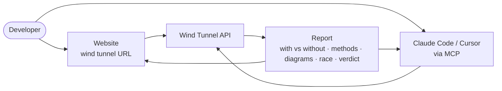
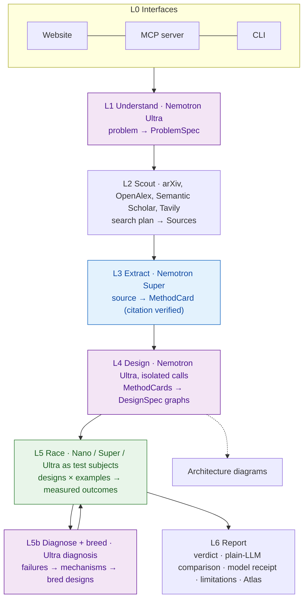
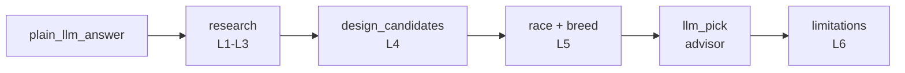

# Wind Tunnel Architecture

Wind Tunnel finds the methods that exist for a problem in papers and on the web. It turns them into candidate architectures, tests those candidates on the user's own examples, and reports the measured winner with citations.

LLMs are good at **generating** designs and bad at **judging** them, so Nemotron generates and measurement judges.

## User flow

1. **Website.** Pick a sample task, or describe your own and upload examples. One results page then shows four sections:
   - **A. Without vs With:** a plain LLM's answer next to Wind Tunnel's.
   - **B. Methods found:** cards with verified citations.
   - **C. Architectures:** a diagram for each candidate, colored by the model that runs each step.
   - **D. The race:** live results ending in the verdict.

   The **Explore** page is a gallery of architecture patterns, showing when each works and when it breaks.
2. **MCP.** A coding agent calls `find_methods`, `design_candidates`, `race` and `get_report`. It gets structured results plus a report link, then writes the code for the winner.

## System layers

| Layer | Model | Input → Output | Status |
|---|---|---|---|
| **L0 Interfaces** | none | user ↔ engine | Done. CLI (`windtunnel run` runs everything; `research`, `race`, `models` and `budget` run single stages), website (`uv run uvicorn windtunnel.api:app`) and MCP server ([docs/MCP.md](docs/MCP.md)). |
| **L1 Understand** | Ultra | problem text, constraints → `ProblemSpec` {requirements, constraints, success metric, problem types, search queries, other-field analogy queries} | Done, with an offline keyword fallback. |
| **L2 Scout** | none (search APIs) | search queries → `Source[]` (title, authors, year, arXiv/DOI/URL, abstract), deduplicated. Includes recent papers, long-tail papers and papers from other fields. Providers: arXiv, OpenAlex, Semantic Scholar, Tavily. | Done. |
| **L3 Extract** | Super | `Source` → `MethodCard` {mechanism, when it works, when it breaks, reported results, citation}. The citation always comes from the search index, never from model text; it is shown as verified only if it has an arXiv ID or DOI. | Done, with an offline fallback per card. |
| **L4 Design** | Ultra, isolated calls | `ProblemSpec` + `MethodCard[]` → candidate designs. One call per runnable family the research supports, plus a wildcard slot fed other-field and long-tail cards. Replies are validated strictly (tiers, clamped params, `based_on` limited to the cards given), near-duplicates are dropped, and a baseline (Nano single call) and the typical LLM default (Ultra crew) are always added. Each design compiles to a runnable pipeline **and** a `DesignGraph`. | Done. Offline mode maps research families to templates. |
| **L5 Race** | Nano / Lightning / Super / Ultra as test subjects | designs × examples → accuracy ± CI, $/1k, p50 latency. Successive halving with a multiplicity-corrected exact sign test eliminates designs, and the verdict picks the cheapest design shown to be within a 0.05 accuracy margin of the best (others are inconclusive). Budget refusals and API outages are left unscored. Families: single call, self-check, self-consistency, plan-execute, orchestrator-workers and **cascade** (cheap answers, escalate on disagreement). | Done. |
| **L5b Diagnose and breed** | Ultra (diagnosis) + rules | race → failure modes from a fixed taxonomy (offline evidence, merged with Ultra's reading of failure examples) → mechanisms from other fields (`mechanisms.json`, each with a source) applied as mutations → bred designs race the survivors. With enough examples a held-out split decides the final race. | Done. |
| **L6 Report** | none | everything above → `windtunnel.engine.run_wind_tunnel` report: plain-LLM answer vs verdict, methods, candidates with Mermaid diagrams, leaderboard, bred designs and lineage, advisor pick, limitations computed from the run, model receipt, Atlas records | Done. Next: an Atlas prior that predicts the leaderboard from past outcomes. |

### The engine

`run_wind_tunnel(problem, task, client)` runs the stages in order and records each in
the model receipt with who produced it (a model key, `offline-heuristic` or `mock`), its
cost and its duration:

An optional `progress(stage, status)` callback lets the web app and MCP server show
live stages. With no client, every model stage uses its offline fallback, the race runs
on the mock client, and the report is labelled `mode: "offline"` and
`provenance: "mock"`. A real client must be wrapped in `BudgetGuard` by the caller;
the CLI is the only place that constructs one.

### Design rules
- **Diagrams are generated from the same graph that runs.** They can't drift from what was tested.
- **Every output records which model produced it** (the "model receipt").
- **Reported evidence and measured evidence are always labelled separately.**
- **Mock runs are always marked `provenance: "mock"`** and are never quoted as results.
- **NVIDIA models are always called through Nebius Token Factory.**
