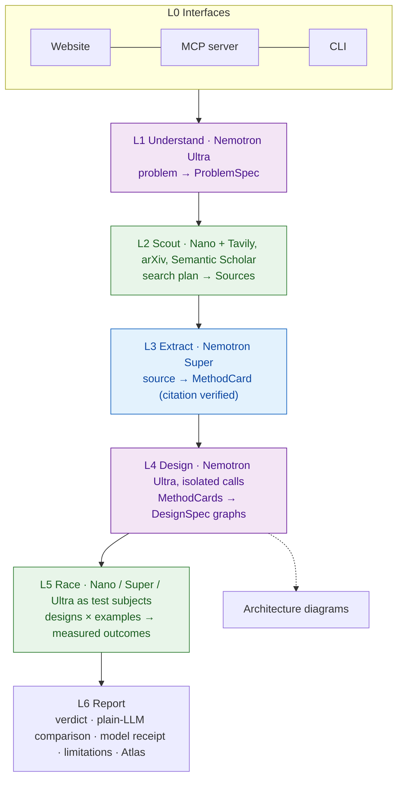

# Wind Tunnel Architecture

Wind Tunnel finds the methods that exist for a problem in papers and on the web. It turns them into candidate architectures, tests those candidates on the user's own examples, and reports the measured winner with citations.

LLMs are good at **generating** designs and bad at **judging** them, so Nemotron generates and measurement judges.

## User flow

1. **Website.** Pick a sample task, or describe your own and upload examples. One results page then shows four sections:
   - **A. Without vs With:** a plain LLM's answer next to Wind Tunnel's.
   - **B. Methods found:** cards with verified citations.
   - **C. Architectures:** a diagram for each candidate, colored by the model that runs each step.
   - **D. The race:** live results ending in the verdict.

   The **Explore** page is a gallery of architecture patterns, showing when each works and when it breaks.
2. **MCP.** A coding agent calls `find_methods`, `design_candidates`, `race` and `get_report`. It gets structured results plus a report link, then writes the code for the winner.

## System layers

| Layer | Model | Input → Output | Status |
|---|---|---|---|
| **L0 Interfaces** | none | user ↔ API | CLI done. Website and MCP next. |
| **L1 Understand** | Ultra | problem text, constraints → `ProblemSpec` {requirements, constraints, success metric, problem types, search queries} | next |
| **L2 Scout** | Nano (query expansion) | search queries → `Source[]` (title, authors, year, arXiv/DOI/URL, abstract), deduplicated. It deliberately includes recent papers, long-tail papers and papers from other fields. | next |
| **L3 Extract** | Super | `Source` → `MethodCard` {mechanism, when it works, reported results and their conditions, limitations, code link, citation}. A citation is shown as verified only if its ID resolves. | next |
| **L4 Design** | Ultra | `ProblemSpec` + `MethodCard[]` → `DesignSpec[]`. Each candidate comes from a separate call, has a different family, and links to the cards it drew on. Each compiles to a runnable pipeline **and** a `DesignGraph`. | graph + diagrams done; generator next |
| **L5 Race** | Nano / Super / Ultra | designs × examples → accuracy ± CI, $/1k, p50 latency. Successive halving with paired bootstrap eliminates designs, and the verdict picks the cheapest design tied with the best. | done |
| **L6 Report** | none | race + cards + advisor → verdict, "LLM would have picked", model receipt, limitations, Atlas records | partly done |

### Design rules
- **Diagrams are generated from the same graph that runs.** They can't drift from what was tested.
- **Every output records which model produced it** (the "model receipt").
- **Reported evidence and measured evidence are always labelled separately.**
- **Mock runs are always marked `provenance: "mock"`** and are never quoted as results.
- **NVIDIA models are always called through Nebius Token Factory.**
