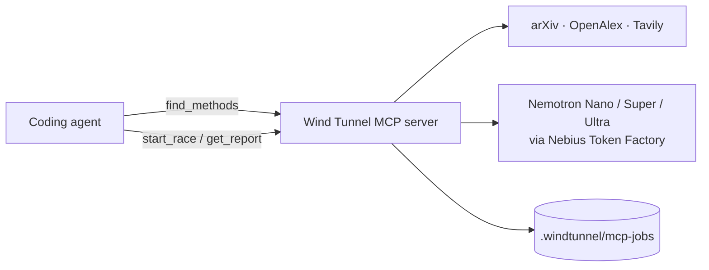

# Wind Tunnel MCP server

The MCP server gives coding agents (Claude Code, Cursor, VS Code Copilot) a way to **measure**
which AI architecture works for a feature before writing it. Today they guess.

The host agent only decides *when* to call a tool. All of Wind Tunnel's reasoning runs
server-side: research, card extraction, design and the race itself run on NVIDIA Nemotron
models through Nebius Token Factory. The server does not use MCP sampling, so the host model
never does Wind Tunnel's work.



## Modes: read these before trusting any number

Every response carries a `mode`:

| mode | meaning | quote it? |
|---|---|---|
| `nemotron` | Research/design ran on Nemotron. A race in this mode is **measured**: real model answers scored against your labels. | yes |
| `offline` | No `NEBIUS_API_KEY`. The paper and web search is real, but the research plan and method cards come from heuristics. | the citations, yes; the summaries are rough |
| `mock` | The race simulated model answers from your labels (`provenance: "mock"`, `do_not_quote: true`, verdict prefixed `MOCK`). | **never** |

Without a key, everything still runs: research is `offline` and races are `mock`. Pass
`mock: true` to `start_race` to force a free plumbing check even when you have a key.

## Setup

You need [uv](https://docs.astral.sh/uv/) and a checkout of this repo. Put keys in `<repo>/.env`
or in the environment. The server reads `.env` from its working directory, or from
`WINDTUNNEL_HOME` if that is set.

```
NEBIUS_API_KEY=...            # optional; without it you get offline research and mock races
TAVILY_API_KEY=...            # optional; adds web results to the paper search
WINDTUNNEL_BUDGET_USD=10      # hard cap on real spend across all runs (BudgetGuard)
```

Check that it starts. It speaks MCP on stdio, so it waits silently; stop it with Ctrl-C:

```bash
uv --directory /path/to/windtunnel run windtunnel-mcp
```

### Claude Code

```bash
claude mcp add windtunnel -- uv --directory /path/to/windtunnel run windtunnel-mcp
```

To use it in every project, add `--scope user`. To pass a key without a `.env` file, add
`--env NEBIUS_API_KEY=...` before `windtunnel`. Run `/mcp` in a session to confirm it is
connected.

**Plugin (MCP server plus a skill).** [`integrations/claude-code`](../integrations/claude-code)
is a Claude Code plugin. It registers the server and adds a `wind-tunnel` skill that tells the
agent to call Wind Tunnel *before choosing an AI architecture or model for a feature*.

```bash
claude --plugin-dir /path/to/windtunnel/integrations/claude-code          # try it for one session
```

To install it permanently from a local checkout, run this inside Claude Code:
`/plugin marketplace add /path/to/windtunnel/integrations/claude-code`, then
`/plugin install windtunnel@windtunnel`.

The plugin starts the server with `uvx --from $WINDTUNNEL_SOURCE windtunnel-mcp`.
`WINDTUNNEL_SOURCE` defaults to the GitHub repo. Set it to a local checkout path to run your
working copy. State (spend ledger, search cache, jobs) goes to the plugin's data directory.
Keys come from `NEBIUS_API_KEY` / `TAVILY_API_KEY` in the environment you launch `claude`
from.

### Cursor

`~/.cursor/mcp.json` (global) or `.cursor/mcp.json` (per project):

```json
{
  "mcpServers": {
    "windtunnel": {
      "command": "uv",
      "args": ["--directory", "/path/to/windtunnel", "run", "windtunnel-mcp"]
    }
  }
}
```

### VS Code (Copilot agent mode)

`.vscode/mcp.json`:

```json
{
  "servers": {
    "windtunnel": {
      "type": "stdio",
      "command": "uv",
      "args": ["--directory", "/path/to/windtunnel", "run", "windtunnel-mcp"]
    }
  }
}
```

For both, keys come from `/path/to/windtunnel/.env`. You can also add an `env` block to the
server entry.

## Tools

Every tool returns compact JSON with `mode`, `mode_note`, `warnings` and a `receipt`. The
receipt records which model (or heuristic) produced each part, what it cost, and the spend cap.

### `find_methods(problem, max_sources=12)`
L1 to L3. It parses the problem, searches arXiv, OpenAlex and Tavily (including recent,
long-tail and other-field papers), and turns each source into a method card.

Returns:
- `problem_spec`: summary, problem types, requirements, constraints, success metric and the
  queries it ran.
- `methods`: one entry per method family, with up to 5 cards each. A card has `name`, `family`,
  `mechanism`, `works_when`, `breaks_when`, `reported_result`, `relevance` (0-3), `flags`
  (`recent`, `long-tail`, `other-field`, `web`), `verified`, `title`, `url` and `year`.

Citations always come from the search index's own record, never from model text.
`verified: true` means the arXiv ID or DOI resolves. Takes 10-60 s because the search is live.
The result is cached in-process, so later calls on the same problem reuse it.

### `design_candidates(problem)`
L4. Turns the research into runnable candidates. Each has `id`, `family`, `model` (Nemotron
tier), `params`, `role` and `rationale`:
- `role` is `baseline` (cheapest), `candidate` (from the research) or `llm-default` (the
  multi-agent design an LLM usually recommends, included so it gets tested).
- `based_on` lists the cited cards (title, URL, year) the candidate draws on.
- `mermaid` is the diagram, generated from the same graph the race runs.

### `start_race(problem, examples, labels?, scorer="exact", output_instructions?, max_cost_per_1k?, max_p50_latency_s?, mock=false)`
L5. Starts the whole pipeline in a background thread and **returns a `job_id` immediately**.
The pipeline is research, then design, then the LLM-advisor pick, then the race.

- `examples`: `[{"input": "...", "expected": "..."}]`. You need at least 5; 30-100 is
  recommended. Rows over `WINDTUNNEL_MCP_MAX_EXAMPLES` (default 100) are dropped, and inputs are
  truncated to 4000 characters.
- `labels`: the allowed answers for classification. They become the output instructions.
- `scorer`: `exact`, `contains` or `numeric`.
- The cost and latency limits eliminate designs that break them.

With `NEBIUS_API_KEY`, the race runs on Nemotron through `BudgetGuard(TokenFactoryClient())`.
Without it, or with `mock: true`, it runs on the mock client and is labelled `mock`.

### `get_report(job_id)`
Returns `status` (`queued`, `running`, `done`, `failed` or `interrupted`) and `progress`
(`stage`, `elapsed_s`, `model_calls`, cost so far). When the job is done, `result` contains:
- `verdict`, `provenance` and `do_not_quote`.
- `recommended`: the cheapest design statistically tied with the best, with its diagram and
  citations.
- `best_id` and `tied_ids`.
- `leaderboard` rows: `accuracy`, `accuracy_ci95`, `cost_per_1k_usd`, `p50_latency_s`, `n`,
  `errors`, `status` (recommended / tied / alive / eliminated with reason).
- `advisor`: what Nemotron Ultra would have picked *without* measuring, and how that pick
  compares.
- `limitations`, `total_cost_usd` and the `receipt`.

Jobs are also written to `.windtunnel/mcp-jobs/<job_id>.json`, which includes the full race
export, research and candidates. Finished reports therefore survive a server restart. A job
that was still running when the server stopped reports `interrupted`.

### `compare_with_plain_llm(problem)`
The "without vs with" view. `without_wind_tunnel` is Nemotron Ultra answering from memory: no
search, no citations, not tested. It is `available: false` in offline mode. `with_wind_tunnel`
contains the method families found, the top verified citations, the candidates that would be
raced, and `tested: false` until you race.

### Prompt: `design(problem)`
A ready-made prompt that walks the agent through four steps: `find_methods`, collecting real
labelled examples (never invented), `start_race`, then polling `get_report`. If the result is
measured, the agent then implements the winner from its diagram and adds the examples as a
regression test. In Claude Code it appears as `/mcp__windtunnel__design`.

## Worked example: without vs with Wind Tunnel

The "without" side below is illustrative. The "with" side uses real tool output from this
repo's bundled 40-ticket `tasks/ticket_triage` fixture, run with no API key. So the research
is `offline` and the race is `mock`, and the race numbers are simulated, which the output says
itself.

**Without Wind Tunnel**

> **User:** Add ticket routing to our support inbox: billing, bug, account_access, shipping,
> feature_request. Keep it under $2 per 1000 tickets.
>
> **Agent:** I'll build a multi-agent pipeline. A router agent classifies the ticket, then
> specialist agents verify the category before it's assigned. I'll use the largest model for
> the router for accuracy. *(No sources, no test on your tickets, no cost estimate.)*

**With Wind Tunnel**

> **User:** Same request.
>
> **Agent → `find_methods`**: `mode: offline`, 10 sources, 10 with verified IDs. Families:
> `self_consistency` (6), `self_check` (3), `fine_tuning` (1). Top cards:
> - ✓ *Ranked Voting based Self-Consistency of Large Language Models* (2025, recent):
>   arxiv.org/abs/2505.10772
> - ✓ *Cost-Aware Model Selection for Text Classification: Multi-Objective Trade-offs* (2026, recent):
>   arxiv.org/abs/2602.06370
> - ✓ *The evidential independent verification of software of information and control systems*
>   (2011, long-tail, other-field): doi.org/10.1109/ewdts.2011.6116420
>
> **Agent:** The literature points at cheap voting and verification, not multi-agent crews.
> I found 40 labelled tickets in `tasks/ticket_triage/examples.jsonl`. Racing them now.
>
> **Agent → `start_race`**(problem, 40 examples, labels, `max_cost_per_1k: 2.0`) →
> `{"job_id": "99c58bd2a81d", "mode": "mock", ...}`
>
> **Agent → `get_report`** →
> ```
> MOCK (simulated, not a result): self-consistency-nano has the highest measured accuracy
> and is the cheapest design tied with it.
> recommended  self-consistency-nano  0.95 (0.88-1.00)  $0.039/1k  p50 0.47s  n=40
> tied         crew-ultra             0.90 (0.80-0.97)  $0.329/1k  p50 5.90s  n=40
> out round 1  baseline-nano          0.60 (0.30-0.90)  $0.008/1k  n=10
> out round 1  self-check-nano        0.50 (0.20-0.80)  $0.017/1k  n=10
> advisor (ultra) would have picked: baseline-nano  (mock advisor; ignore)
> ```
>
> **Agent:** This was a **mock** race because no `NEBIUS_API_KEY` is set. The numbers are
> simulated and don't tell us which design is better. The pipeline works end to end. Set the
> key and I'll re-race on real Nemotron models. Then I'll implement the `recommended` design from
> its diagram, which is the cheapest design tied with the best, whatever it turns out to be.

With a key, the same calls return `mode: nemotron`, Nemotron-written method cards, a real
plain-LLM answer in `compare_with_plain_llm`, and `provenance: "measured"` race numbers.

## Limits

- **Races take minutes.** A 40-example race of four designs makes several hundred Nemotron calls. That is why `start_race` returns a job and you poll `get_report`. Spend is capped by
  `WINDTUNNEL_BUDGET_USD`. If the cap is hit, the job fails with `BudgetExceeded` and nothing
  more is spent.
- **Examples are required.** No examples means no measurement. With fewer than about 30,
  confidence intervals are too wide to separate close designs, and the report says so. Examples
  must be labelled by a person or come from real data. The agent must not invent them.
- **Data leaves your machine.** The problem text goes to the search providers (arXiv, OpenAlex,
  Tavily). On real runs, the problem and every example go to Nebius Token Factory. Jobs,
  including model outputs per example, are stored under `.windtunnel/mcp-jobs/`. Don't race
  data you can't send to those services.
- **Candidates are templates for now.** The five runnable families are single call,
  self-check, self-consistency, plan-execute and orchestrator-workers, mapped from the research
  and spread across Nemotron tiers. The Nemotron Ultra task-specific generator plugs into the
  same interface.
- **Text in, text out.** The scorers compare the final answer to `expected` (exact, contains
  or numeric). Tasks that need tools, retrieval over your corpus, or graded rubrics are not
  measured yet.
- **One process.** Running jobs live in the server process. A restart keeps finished reports
  (they are on disk) but interrupts running ones. Shareable report pages come from the web app.
