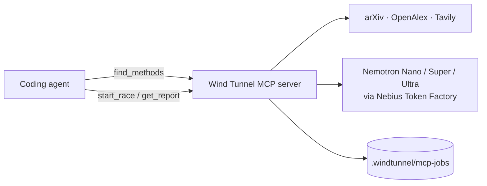

# Wind Tunnel MCP server

The MCP server gives coding agents (Claude Code, Cursor, VS Code Copilot) a way to **measure**
which AI architecture works for a feature before writing it. Today they guess.

The host agent only decides *when* to call a tool. All of Wind Tunnel's reasoning runs
server-side: research, card extraction, design and the race itself run on NVIDIA Nemotron
models through Nebius Token Factory. The server does not use MCP sampling, so the host model
never does Wind Tunnel's work.



## Modes: read these before trusting any number

Every response carries a `mode` and a `labels` list. The labels are the short form agents
should repeat to the user: `OFFLINE` (heuristic research), `MOCK` and `SIMULATED` (a simulated
race and its simulated costs), `NEMOTRON` (model-written research) and `MEASURED` (a real race).
The labels say what actually produced the output, not whether a key is set: if Nemotron's
replies were unusable or refused and every research and design step fell back to the
heuristics, the label is `OFFLINE`; if only some did, it is `NEMOTRON` plus `PARTLY-OFFLINE`
(research `mode: "mixed"`). A job with no result yet is `NEMOTRON-REQUESTED`, plus `FAILED` if
it stopped before producing one.
In a finished report, `mode` describes the research and `provenance` describes the race.

Invalid arguments and unknown job ids come back as MCP tool errors (`isError: true`).

| mode | meaning | quote it? |
|---|---|---|
| `nemotron` | Research/design ran on Nemotron. A race in this mode is **measured**: real model answers scored against your labels. | yes |
| `offline` | No `NEBIUS_API_KEY`. The paper and web search is real, but the research plan and method cards come from heuristics. | the citations, yes; the summaries are rough |
| `mixed` | Nemotron ran, but the research plan or some method cards fell back to the heuristics (see `warnings`). | the citations, yes; treat the fallback cards as rough |
| `mock` | The race simulated model answers from your labels (`provenance: "mock"`, `do_not_quote: true`, labels `MOCK` + `SIMULATED`, verdict headline prefixed `[MOCK, not a result]`). | **never** |

**Read `result.limitations` before acting on any verdict.**

Without a key, everything still runs: research is `offline` and races are `mock`. Pass
`mock: true` to `start_race` to force a free, fully offline plumbing check even when you have
a key. The plain-LLM answer and the LLM advisor pick need Nemotron; offline they are reported
as unavailable (`available: false`, `text: null` and an `unavailable_reason`), never made up.

## Setup

You need [uv](https://docs.astral.sh/uv/) and a checkout of this repo. Put keys in `<repo>/.env`
or in the environment. The server reads `.env` from its working directory, or from
`WINDTUNNEL_HOME` if that is set.

```
NEBIUS_API_KEY=...            # optional; without it you get offline research and mock races
TAVILY_API_KEY=...            # optional; adds web results to the paper search
WINDTUNNEL_BUDGET_USD=10      # hard cap on real spend across all runs (BudgetGuard)
```

Check that it starts. It speaks MCP on stdio, so it waits silently; stop it with Ctrl-C:

```bash
uv --directory /path/to/windtunnel run windtunnel-mcp
```

### Claude Code

```bash
claude mcp add windtunnel -- uv --directory /path/to/windtunnel run windtunnel-mcp
```

To use it in every project, add `--scope user`. To pass a key without a `.env` file, add
`--env NEBIUS_API_KEY=...` before `windtunnel`. Run `/mcp` in a session to confirm it is
connected.

**Plugin (MCP server plus a skill).** [`integrations/claude-code`](../integrations/claude-code)
is a Claude Code plugin. It registers the server and adds a `wind-tunnel` skill that tells the
agent to call Wind Tunnel *before choosing an AI architecture or model for a feature*.

```bash
claude --plugin-dir /path/to/windtunnel/integrations/claude-code          # try it for one session
```

To install it permanently from a local checkout, run this inside Claude Code:
`/plugin marketplace add /path/to/windtunnel/integrations/claude-code`, then
`/plugin install windtunnel@windtunnel`.

The plugin starts the server with `uvx --from $WINDTUNNEL_SOURCE windtunnel-mcp`.
`WINDTUNNEL_SOURCE` defaults to the GitHub repo. Set it to a local checkout path to run your
working copy. State (spend ledger, search cache, jobs) goes to the plugin's data directory.
Keys come from `NEBIUS_API_KEY` / `TAVILY_API_KEY` in the environment you launch `claude`
from.

### Cursor

`~/.cursor/mcp.json` (global) or `.cursor/mcp.json` (per project):

```json
{
  "mcpServers": {
    "windtunnel": {
      "command": "uv",
      "args": ["--directory", "/path/to/windtunnel", "run", "windtunnel-mcp"]
    }
  }
}
```

### VS Code (Copilot agent mode)

`.vscode/mcp.json`:

```json
{
  "servers": {
    "windtunnel": {
      "type": "stdio",
      "command": "uv",
      "args": ["--directory", "/path/to/windtunnel", "run", "windtunnel-mcp"]
    }
  }
}
```

For both, keys come from `/path/to/windtunnel/.env`. You can also add an `env` block to the
server entry.

## Tools

Every tool returns compact, strict JSON with `mode`, `labels`, `mode_note`, `warnings` and a
receipt. The receipt records which model (or heuristic) produced each part, what it cost, and
the spend cap. Numbers that could not be measured (NaN or infinite, e.g. the accuracy of a
design with no scored examples) come back as `null`, never as `NaN`. Warnings are passed
through in full up to 10, each clipped to 300 characters, and a last line counts any more.

### `find_methods(problem, max_sources=12)`
L1 to L3. It parses the problem, searches arXiv, OpenAlex and Tavily (including recent,
long-tail and other-field papers), and turns each source into a method card.

Returns:
- `problem_spec`: summary, problem types, requirements, constraints, success metric and the
  queries it ran.
- `methods`: one entry per method family, with up to 5 cards each. A card has `name`, `family`,
  `mechanism`, `works_when`, `breaks_when`, `reported_result`, `relevance` (0-3), `flags`
  (`recent`, `long-tail`, `other-field`, `web`), `verified`, `title`, `url`, `year` and
  `extracted_by` (a model key or `offline-heuristic`).
- `warnings`: search providers that failed, cards that fell back to the heuristic, and so on.

Citations always come from the search index's own record, never from model text.
`verified: true` means the record has an arXiv ID or DOI from a scholarly index (the ID is not
resolved online). Takes 10-60 s because the search is live. The result is cached in-process, so
later calls on the same problem reuse it; a result that fell back to the heuristic is not cached,
so the next call tries Nemotron again.

### `design_candidates(problem)`
L4. Turns the research into runnable candidates. Each has `id`, `family`, `model` (Nemotron
tier), `tiers`, `params`, `role`, `rationale` and `expected_tradeoff`:
- `tiers` lists every Nemotron tier the design calls, read from its graph. A `cascade` lists
  its cheap tier and the tier it escalates to (e.g. `["nano", "ultra"]`); the `llm-default`
  crew lists `["super", "ultra"]`.
- `role` is `baseline` (cheapest), `candidate` (from the research) or `llm-default` (the
  multi-agent design an LLM usually recommends, included so it gets tested).
- `based_on` lists the cited cards (title, URL, year) the candidate draws on.
- `mermaid` is the diagram, generated from the same graph the race runs.
- `warnings` includes design slots that were dropped or replaced (near-duplicates, rejected
  replies, over `max_designs`).

The candidates are cached per problem, so `compare_with_plain_llm` and `start_race` with the
same problem show and race exactly this set, and Ultra designs it once.

### `start_race(problem, examples, labels?, scorer="exact", output_instructions?, max_cost_per_1k?, max_p50_latency_s?, mock=false, breed=true)`
L1 to L6. Starts the whole pipeline in a background thread and **returns a `job_id`
immediately**. It runs `windtunnel.engine.run_wind_tunnel`, the same engine as
`windtunnel run`: plain-LLM answer, research, candidate designs, the race with
diagnose-and-breed, the LLM-advisor pick, then limitations.

- `examples`: `[{"input": "...", "expected": "..."}]`. You need at least 5; 30-100 is
  recommended. Inputs and expected answers must be non-empty and inputs unique. Rows over
  `WINDTUNNEL_MCP_MAX_EXAMPLES` (default 100) are dropped, and inputs are truncated to 4000
  characters (a warning says how many were).
- `problem` is capped at 2000 characters and `output_instructions` at 1000, because both are
  sent with every race call. Cost and latency limits must be positive.
- `labels`: the allowed answers for classification. They become the output instructions.
- `scorer`: `exact`, `contains` or `numeric`.
- The cost and latency limits eliminate designs that break them.
- `breed` (default `true`): after the first race, the weaker designs' failures are diagnosed,
  mechanisms from other fields are applied to them as mutations, and the bred designs race the
  survivors. Pass `false` for a single race of the generated candidates.

With `NEBIUS_API_KEY`, the race runs on Nemotron through `BudgetGuard(TokenFactoryClient())`.
Without it, or with `mock: true`, it runs on the mock client and is labelled `mock`.

### `get_report(job_id)`
Returns `status` (`queued`, `running`, `done`, `failed` or `interrupted`), `labels` and
`progress`. Progress comes from the engine's progress callback: `stage` (the stage running
now, then `done`), `stages` (each of `plain_llm_answer`, `research`, `design_candidates`,
`race`, `llm_pick`, `limitations` with `pending`, `running`, `done`, `skipped` or `failed`),
`elapsed_s`, and on real runs `model_calls` and `cost_usd` so far. Mock runs report
`simulated_model_calls` once they finish. When the job is done, `result` contains:

- `labels`, `mode` (research), `provenance` (race), `mode_note` and `do_not_quote`.
- **`limitations`: read these before acting on the verdict.** They are computed from this run:
  mock or offline mode, too few examples, ties and inconclusive designs, early eliminations,
  errors, bred designs' selection bias, the scorer, and what was not produced.
- `verdict`: `headline` (prefixed `[MOCK, not a result]` or `[INCOMPLETE]` when it applies),
  `recommended_id`, `best_id`, `tied_ids`, `inconclusive_ids`, `aborted`, `n_examples`,
  `decided_in` (which race decided it), and `vs_llm_default` / `advisor_pick` with their
  numbers and `comparable` (false when they come from a different race than the recommendation).
- `recommended`: the cheapest design statistically tied with the best, with `tiers`,
  `origin` (`candidate`, `baseline`, `llm-default` or `bred`), accuracy with its 95% CI,
  $/1k, p50 latency, `n`, cited `based_on` sources, `lineage` (for a bred design: parent,
  mechanism, failure mode, generation) and its `mermaid` diagram.
- `leaderboard` rows from the deciding race: `tiers`, `origin`, `accuracy`, `accuracy_ci95`,
  `cost_per_1k_usd`, `p50_latency_s`, `n`, `errors`, `unmeasured` (runs left out for
  infrastructure reasons) and `status` (recommended / tied / inconclusive / alive /
  eliminated with reason). `eliminated_earlier` lists designs knocked out in an earlier race.
- `breeding` (`{"enabled": false, ...}` with `breed=false`):
  - `diagnoses`: per weak design, its `failure_modes` (`mode`, `share` of examples,
    `flagged_by`), its top label confusions and who diagnosed it.
  - `mechanisms_applied`: which mechanism (with its field and source) was applied to which
    parent to target which failure, and the `bred_id` it produced.
  - `bred`: the bred designs with `tiers`, `parent_id`, `mechanism`, `failure_mode` and
    `generation`.
  - `selection_bias` and `note`: with about 67+ examples a 30% held-out split decides the final
    race (`holdout_examples` > 0). With fewer, bred designs were picked from failures on the
    same examples they are scored on, so **their scores are optimistic**.
  - `races`: each race's role, size and recommendation.
- `plain_llm` and `advisor`: the "without" answer and what Nemotron Ultra would have picked
  without measuring, or `available: false` with the reason.
- `research` (source and card counts per family), `candidates` (ids, tiers, roles, whether
  raced), `warnings`, the engine's `model_receipt` (who produced each stage, cost, seconds,
  and `simulated_cost_usd` for a mock race), `total_cost_usd` (real spend only),
  `simulated_cost_usd` (mock only), `spend_cap` (real runs) and `next`.

Jobs are also written to `.windtunnel/mcp-jobs/<job_id>.json` after every stage. The file
includes the full engine report (research, candidates with diagrams, every race with
per-example outputs, breeding). Finished reports therefore survive a server restart. A job
that was still running when the server stopped reports `interrupted`; one still running in
another MCP server process that shares the jobs directory reports `running` with a `note`.

### `compare_with_plain_llm(problem)`
The "without vs with" view. `without_wind_tunnel` is Nemotron Ultra answering from memory: no
search, no citations, not tested. In offline mode, or if the call fails (spend cap, API
error), it is `available: false` with `text: null` and an `unavailable_reason`: there is no
answer, and an agent must not write one in its place. `with_wind_tunnel`
contains the method families found, the top verified citations, the candidates that would be
raced, and `tested: false` until you race.

### Prompt: `design(problem)`
A ready-made prompt that walks the agent through four steps: `find_methods`, collecting real
labelled examples (never invented), `start_race`, then polling `get_report`. The agent reads
the limitations first, then reports the verdict, leaderboard, bred designs and advisor pick. If
the result is measured, it implements the winner from its diagram and adds the examples as a
regression test. In Claude Code it appears as `/mcp__windtunnel__design`.

## Worked example: without vs with Wind Tunnel

The "without" side below is illustrative. The "with" side uses real tool output from this
repo's bundled 40-ticket `tasks/ticket_triage` fixture, run with no API key. So the research
is `offline` and the race is `mock`, and the race numbers are simulated, which the output says
itself.

**Without Wind Tunnel**

> **User:** Add ticket routing to our support inbox: billing, bug, account_access, shipping,
> feature_request. Keep it under $2 per 1000 tickets.
>
> **Agent:** I'll build a multi-agent pipeline. A router agent classifies the ticket, then
> specialist agents verify the category before it's assigned. I'll use the largest model for
> the router for accuracy. *(No sources, no test on your tickets, no cost estimate.)*

**With Wind Tunnel**

> **User:** Same request.
>
> **Agent → `find_methods`**: `mode: offline`, 10 sources, 10 with verified IDs. Families:
> `self_consistency` (6), `self_check` (3), `fine_tuning` (1). Top cards:
> - ✓ *Ranked Voting based Self-Consistency of Large Language Models* (2025, recent):
>   arxiv.org/abs/2505.10772
> - ✓ *Cost-Aware Model Selection for Text Classification: Multi-Objective Trade-offs* (2026, recent):
>   arxiv.org/abs/2602.06370
> - ✓ *The evidential independent verification of software of information and control systems*
>   (2011, long-tail, other-field): doi.org/10.1109/ewdts.2011.6116420
>
> **Agent:** The literature points at cheap voting and verification, not multi-agent crews.
> I found 40 labelled tickets in `tasks/ticket_triage/examples.jsonl`. Racing them now.
>
> **Agent → `start_race`**(problem, 40 examples, labels, `max_cost_per_1k: 2.0`) →
> `{"job_id": "4d148afee2b4", "mode": "mock", "labels": ["OFFLINE", "MOCK", "SIMULATED"], "breed": true, ...}`
>
> **Agent → `get_report`** → `labels: ["OFFLINE", "MOCK", "SIMULATED"]`, `do_not_quote: true`.
> The fields, condensed:
> ```
> limitations[0]  MOCK race: answers were simulated from your labels ... Never quote them.
> limitations[1]  OFFLINE mode: ... search plan, method cards and candidate designs come from heuristics
> verdict  [MOCK, not a result] crew-ultra has the highest measured accuracy (0.95 on 40 examples).
>          Inconclusive: baseline-nano, self-check-nano, self-consistency-nano, ... more examples could change the pick.
> recommended   crew-ultra                          llm-default  0.95  (0.84-0.99)  $0.315/1k  p50 5.89s  n=40  super+ultra
> inconclusive  self-consistency-nano.double-entry  bred         0.95  (0.84-0.99)  $0.073/1k  p50 1.51s  n=40  nano+ultra
> inconclusive  self-consistency-nano               candidate    0.93  (0.80-0.97)  $0.037/1k  p50 0.46s  n=40  nano
> inconclusive  self-check-nano                     candidate    0.90  (0.77-0.96)  $0.017/1k  p50 0.79s  n=40  nano
> inconclusive  baseline-nano                       baseline     0.78  (0.63-0.88)  $0.008/1k  p50 0.40s  n=40  nano
> breeding  diagnoses: self-consistency-nano inconsistent (17.5%), baseline-nano label_confusion (12.5%), ...
>           mechanisms_applied: Double-entry bookkeeping (accounting) -> self-consistency-nano.double-entry,
>                               Damping (control theory), Triple modular redundancy (fault-tolerant computing)
>           selection_bias: present: bred designs' scores are optimistic (40 examples, no held-out split)
> plain_llm / advisor: available: false (needs Nemotron)
> ```
>
> **Agent:** I read the limitations first. This was a **mock** race with offline research,
> because no `NEBIUS_API_KEY` is set. The numbers are simulated and don't tell us which design
> is better, and even on real models 40 examples left most designs inconclusive. The bred
> cascade (`nano` escalating to `ultra`) is worth watching, but it was bred from failures on
> the same 40 examples, so its score is optimistic. The pipeline works end to end. Set the key
> and give me 200+ real tickets, and I'll re-race on Nemotron. Then I'll implement the
> `recommended` design from its diagram, whatever it turns out to be.

With a key, the same calls return `mode: nemotron`, Nemotron-written method cards, a real
plain-LLM answer and advisor pick, Nemotron-assisted failure diagnoses, and
`provenance: "measured"` race numbers labelled `MEASURED`.

## Limits

- **Races take minutes.** A 40-example race of four designs makes several hundred Nemotron calls, and
  breeding adds a second race. That is why `start_race` returns a job and you poll `get_report`.
  Spend is capped by `WINDTUNNEL_BUDGET_USD`. If the cap is hit, refused runs are not scored, the
  verdict is marked `[INCOMPLETE]` with no recommendation, and the limitations say so.
- **Examples are required.** No examples means no measurement. With fewer than about 30,
  confidence intervals are too wide to separate close designs, and the report says so. Examples
  must be labelled by a person or come from real data. The agent must not invent them.
- **Data leaves your machine.** The problem text goes to the search providers (arXiv, OpenAlex,
  Tavily). On real runs, the problem and every example go to Nebius Token Factory. Jobs,
  including model outputs per example, are stored under `.windtunnel/mcp-jobs/`. Don't race
  data you can't send to those services.
- **Built-in families only.** The runnable families are single call, self-check,
  self-consistency, plan-execute, orchestrator-workers and cascade. With a key, Nemotron Ultra
  generates task-specific candidates within them; offline they are templates mapped from the
  research.
- **Text in, text out.** The scorers compare the final answer to `expected` (exact, contains
  or numeric). Tasks that need tools, retrieval over your corpus, or graded rubrics are not
  measured yet.
- **One process.** Running jobs live in the server process. A restart keeps finished reports
  (they are on disk) but interrupts running ones. Shareable report pages come from the web app.
